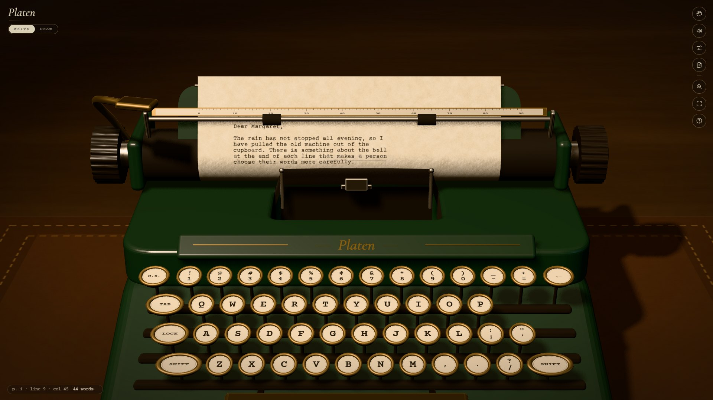
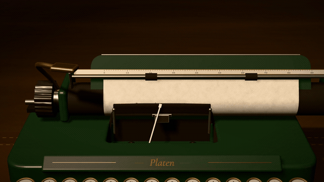
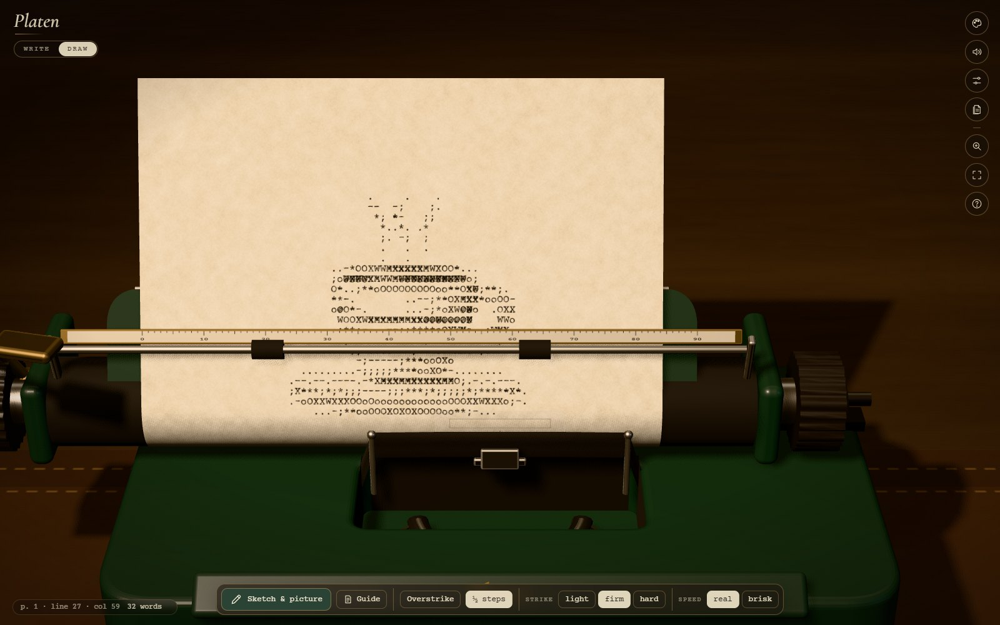
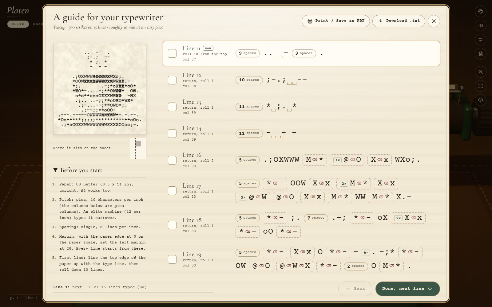
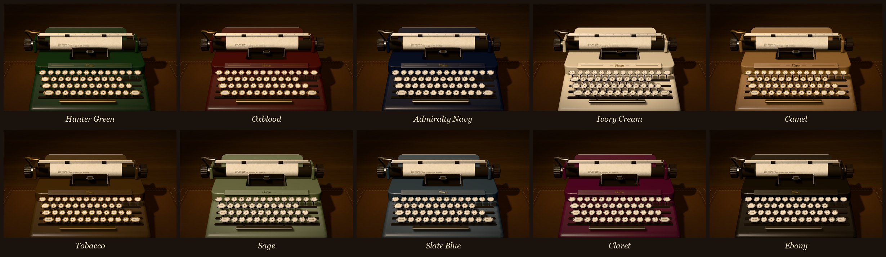
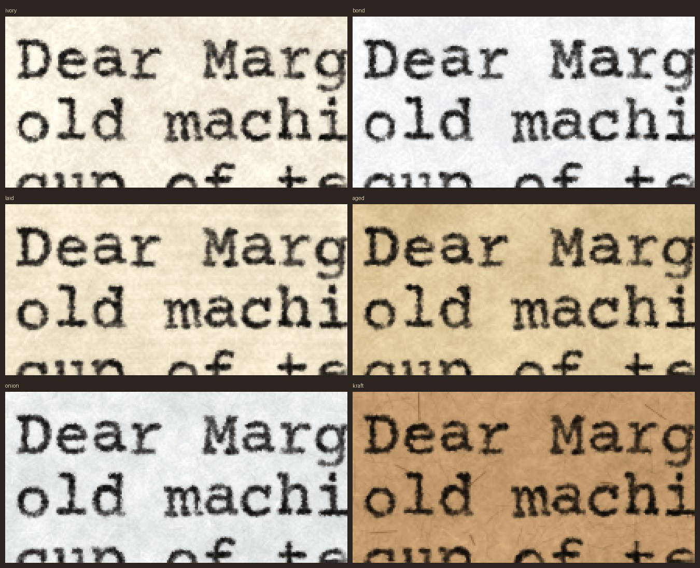

<div align="center">



# Platen

**A cozy typewriter for the web.**<br>
A 3D manual typewriter in your browser, with real-feeling paper, ribbon ink and mechanical sound.<br>
For writing slowly, and for typewriter art.

[](https://winchxyz.github.io/platen/)
[](https://winchxyz.github.io/platen/docs/platen-intro.mp4)

[](https://github.com/winchxyz/platen/actions/workflows/tests.yml)
[](LICENSE)
[](https://threejs.org)
[](#sound)
[](js/)
[](#run-it-locally)
[](#privacy)
[](https://github.com/winchxyz/platen/commits/main)

</div>

---

<p align="center">
  <a href="https://winchxyz.github.io/platen/docs/platen-intro.mp4">
    
  </a>
  <br><sub>▶ <a href="https://winchxyz.github.io/platen/docs/platen-intro.mp4">Watch the 40-second intro with sound</a></sub>
</p>

## What it is

Platen is a typewriter simulator made for the pleasure of typing. The strike point stays put while the
carriage slides under it, one character at a time. The bell rings eight characters before the margin, the
carriage locks there until you throw it back, and every finished sheet goes into a stack you can read,
copy, save or print.

Nothing in it is a recording or a photo. The machine is modelled in code, the paper and the ink are drawn
pixel by pixel, and every clack, ratchet and ding is synthesised as you type.

## Write, draw, or follow a guide

### ✍️ Write

| | |
|---|---|
| **Real carriage** | The column you type is always in the middle; the carriage, platen and paper move. |
| **Margin bell & lock** | The bell rings near the right margin. Keep typing and the keys jam until you press <kbd>Enter</kbd>. Or switch *Line ends* to **Auto return**. |
| **Correction tape** | <kbd>Backspace</kbd> lifts the letter off and leaves a faint ghost. Or choose **Ink is forever** and overstrike like it's 1958. |
| **Black & red ribbon** | <kbd>Ctrl</kbd>+<kbd>R</kbd> flips the ribbon to its red half. |
| **Pages** | Full sheets roll out and a fresh one rolls in. Read them flat, copy the text, save one page or all of them as **Markdown** (`.md`: paragraphs kept, drawings in code blocks) or `.txt`, or print to PDF. |
| **Save as image** | <kbd>Ctrl</kbd>+<kbd>S</kbd>: the whole sheet, **just the ink** cropped to your text or drawing (on paper, white or a transparent background), or a photo of the machine. Standard 240 dpi or large 360 dpi PNG, or copy it straight to the clipboard. |

### 🎨 Draw

Typewriter art the old way, and an easy way.

- **By hand**: arrow keys move half a space or half a line, **Overstrike** keeps the carriage still so you can
  stack `O`, `X`, `#` and `@` into darker tones, and a click on the sheet glides the carriage there.
- **Sketch & picture**: draw lines, boxes, ellipses and fills, write big banner letters, or drop in a photo
  (shade, line or stipple style). Press **Type it** and the machine types the whole thing by itself the way
  a person would: the space bar between marks, backspace before every overstrike, a carriage return at the
  end of each line. At a typist's pace (or a brisk one), with **Finish now** when you can't wait.

- **Save it**: <kbd>Ctrl</kbd>+<kbd>S</kbd> exports just the drawing as a PNG, on its paper or on a transparent
  background, ready to post or print.

<p align="center"></p>

### 📜 Guide: type it on your own typewriter

Have a real typewriter? Any drawing (or any sheet) becomes a step-by-step guide: how to set the paper,
margin and spacing, then every line as a short recipe of spaces, characters and overstrikes
(`#/@` = type `#`, backspace, type `@`). Tick lines off as you go on your phone or tablet propped next to
the machine (progress is remembered), or print it / save it as PDF or `.txt`.

<p align="center"></p>

## Old-money enamels

Ten finishes in deep, quiet colours, each with matched chrome or brass trim, and three kinds of keys
(glass-top, black, ivory).

<p align="center"></p>

The machine is a closed-top portable in the spirit of the late-1950s classics: a slim slot shows the
type guide and ribbon, the keys are glass-topped with brass or nickel rings, the platen is soft black
rubber, and it all sits on a leather blotter under a lamp.

| Hunter Green | Oxblood | Admiralty Navy | Ivory Cream | Camel | Tobacco | Sage | Slate Blue | Claret | Ebony |
|:-:|:-:|:-:|:-:|:-:|:-:|:-:|:-:|:-:|:-:|
|  |  |  |  |  |  |  |  |  |  |

## Paper, ribbon, type, light

<p align="center"></p>

- **Six papers**: Cotton Ivory, Bright Bond, Laid Cream (with laid and chain lines), Aged Parchment
  (foxing, darker edges), Onionskin, Kraft.
- **Five ribbons**: Black, Black & Red, Navy, Sepia, Violet copy, from fresh and inky to worn and grey.
- **Three typefaces**: Pica (Courier Prime), Elite (Special Elite), Cutive (Cutive Mono).
- **Real impressions**: every letter sits a little off its line the way it would on one particular
  machine, presses harder or softer with your rhythm, shows the cloth of the ribbon, and darkens when
  you strike it twice.
- **Three moods**: Morning daylight, Lamplight, Midnight.

## Sound

Every sound is synthesised live with the Web Audio API, no samples: the keytop, the typebar slamming
the platen through the ribbon, the escapement tick, the space bar, the margin bell, the line-space
ratchet, the carriage sliding home against its stop, the paper rolling in and out. Two machines
(a light **Portable** and a heavier **Desk machine**) and four ambiences to type under: **rain on the
window**, **fireplace**, **mantel clock**, **summer night**. Headphones recommended.

## Keys

| Key | Does |
|---|---|
| <kbd>Enter</kbd> | Carriage return and line feed |
| <kbd>Backspace</kbd> | Back one space (lifts the letter with correction tape) |
| <kbd>Tab</kbd> | Next tab stop |
| <kbd>←</kbd> <kbd>→</kbd> <kbd>↑</kbd> <kbd>↓</kbd> | Move the carriage, roll the platen (half steps in Draw) |
| <kbd>Ctrl</kbd>+<kbd>R</kbd> | Black / red half of the ribbon |
| <kbd>Ctrl</kbd>+<kbd>Enter</kbd> | Pull the sheet, roll in a fresh one |
| <kbd>Ctrl</kbd>+<kbd>S</kbd> | Save as image (sheet, just the ink, or the machine) |
| <kbd>Esc</kbd> | Hide everything but the machine; stop auto typing |
| Scroll / <kbd>Ctrl</kbd>+scroll | Look up the page / zoom |
| Click the sheet, lever, knob | Move the carriage there / carriage return / roll the platen |

On phones, tap the 3D keys directly, or open your phone's keyboard with the keyboard button (tap it again to close it).

## How it's made

```
index.html          the page, panels and an import map for three.js
js/machine.js       the typewriter: enamel body, glass-top keys, typebar basket, ribbon, carriage,
                    platen, paper bail, return lever, and the sheet bending round the platen
js/scene.js         desk, felt pad, lamp, the three moods, camera rig
js/ink.js           procedural papers and the ink of each impression, drawn pixel by pixel
js/audio.js         the sound engine: modal synthesis of every mechanical event, room reverb, ambiences
js/page.js          carriage rules (margins, bell, lock, tabs, spacing) and text export
js/export.js        PNG export: lifts the ink off the paper (transparent / white) and crops to it
js/art.js           typewriter art: picture -> characters (shade / line / stipple), shapes, banners
js/planner.js       the Sketch & picture panel
js/guide.js         the typing guide: a drawing -> line-by-line instructions for a real typewriter
js/app.js, ui.js    keyboard, auto typing, panels, pages; store.js keeps everything in IndexedDB
js/film.js          the intro film, rendered from the real app on a virtual clock (tools/film.mjs)
```

Static ES modules, no framework, no bundler. The sheet is a 2040 × 2640 canvas (240 dpi, pica pitch,
6 lines per inch); each keystroke paints one impression and uploads only the changed band to the GPU.

## Run it locally

```bash
git clone https://github.com/winchxyz/platen.git
cd platen
node dev-server.js        # http://localhost:8875
```

Any static server works; the modules just need `http://`, not `file://`.

- `npm test` runs the unit tests (carriage rules, text export, typewriter-art conversion, guides).
- `npm run film` re-renders the intro film and `npm run shots` the README images. Both drive headless
  Chromium through `playwright-core` (`npm i`), or set `PLAYWRIGHT_CORE` to a copy you already have.

## Privacy

Your pages never leave your browser. They are stored in IndexedDB on your device; there is no server,
no account and no analytics. Pictures you drop into Draw mode are read locally and never uploaded.

## Credits

- [three.js](https://threejs.org) (MIT), vendored in `js/vendor/`.
- Typefaces from Google Fonts: [Courier Prime](https://fonts.google.com/specimen/Courier+Prime) (OFL),
  [Special Elite](https://fonts.google.com/specimen/Special+Elite) (Apache 2.0),
  [Cutive Mono](https://fonts.google.com/specimen/Cutive+Mono) (OFL),
  [Cormorant Garamond](https://fonts.google.com/specimen/Cormorant+Garamond) (OFL).
- Everything else (model, textures, sounds, pictures) is generated by the code in this repository.

MIT © 2026 winch
